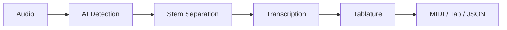

# 🎸 Tab Agent

[](https://github.com/sgm-audio/tab-agent-pro/actions/workflows/ci.yml)
[](https://www.python.org/downloads/)
[](LICENSE)

**Upload guitar or bass audio. Get tablature, MIDI, and JSON back.**

Tab Agent transcribes guitar and bass recordings into playable tablature using
a multi-engine AI pipeline. Works on anything from a clean DI track to a full
mix with drums and vocals.

---

## Quick Start

### Web UI (recommended)

```bash
pip install -r requirements.txt
python app.py
# Open http://localhost:7860
```

> **Linux note (which is most installs, and the image):** Basic Pitch's default
> Linux dependency set pulls TensorFlow `<2.15.1`, which has no Python 3.12+
> wheels and is unused by the ONNX backend. Install Basic Pitch without
> dependencies, then the rest. This is what `Dockerfile` and CI do, and it is
> the supported path — **Python 3.11+ is required**, and the image runs 3.12:
> ```bash
> pip install --no-deps "basic-pitch>=0.4.0,<0.5"
> grep -v '^basic-pitch' requirements.txt > /tmp/req-nobp.txt && pip install -r /tmp/req-nobp.txt
> pip install --no-deps -r requirements.lock   # exact, tested versions
> ```

**Reproducible install:** `requirements.lock` pins the 118 distributions that
actually ship — the runtime closure of the declared dependencies, including
transitive ones, and excluding the TensorFlow tree and NVIDIA CUDA wheels that
this project never installs. CI and the Docker build install from it and then
fail if the environment drifts from it:

```bash
pip install -r requirements.txt
python tools/check_lockfile.py          # verify
python tools/check_lockfile.py --write  # regenerate after a dependency change
```

The server binds to `HOST` (default `0.0.0.0` so Docker containers can reach
it) and listens on `PORT` (default `7860`). Both are read from the environment
or from an optional `.env` file — see `.env.example`.

The **web UI** limits uploads to 50 MB and 5 minutes and accepts
`.wav .mp3 .flac .ogg .m4a .aiff`; results are returned as a ZIP archive. The CLI
has no such limits — it processes whatever file you point it at, however long.

### CLI

```bash
python main.py input/your_song.wav
# Output: output/your_song_lead_guitar.tab
```

Useful flags:

```bash
python main.py song.wav --instrument Bass          # default: Guitar
python main.py song.wav --profile rock_drop_d      # preset profile (see init_memory.py --list)
python main.py song.wav --onset 0.4 --frame 0.3    # override profile thresholds
python main.py song.wav --no-midi --no-tab         # export JSON only
python main.py song.wav --output-dir /tmp/out
```

### Docker

```bash
docker build -t tab-agent .
docker run -p 7860:7860 -v $(pwd)/input:/app/input -v $(pwd)/output:/app/output tab-agent
# or run the CLI inside the image:
docker run -v $(pwd)/input:/app/input -v $(pwd)/output:/app/output tab-agent python main.py input/your_song.wav
```

The image binds `0.0.0.0:7860` and ships Basic Pitch with its ONNX backend plus
the stem-separation stack.

### Validation

```bash
python -m pytest tests/            # 291 tests, 91% coverage
python validate.py                 # end-to-end checklist (PASS/FAIL summary)

python tools/check_index.py           # ReaPack index format
python tools/check_env_example.py     # every documented env var is read
python tools/check_docker_install.py  # basic-pitch pin + required deps
python tools/check_reaper_settings.py # REAPER settings reach main.py
python tools/check_lockfile.py        # installed env == requirements.lock
python tools/check_vulns.py           # advisories: none unaccepted/expired
python tools/simulate_failures.py     # failure modes still behave (15 checks)
```

---

## Pipeline



| Stage | Tool | What it does |
|-------|------|-------------|
| **Quality Analysis** | SunoDetector | Detects AI-generated audio artifacts, adjusts thresholds |
| **Stem Separation** | Demucs (htdemucs) | Splits the mix into vocals / drums / bass / other; `bass` is transcribed as bass and `other` as guitar |
| **Spatial Processing** | Mid-Side | Splits lead (centre) from rhythm (sides) by subtraction |
| **Transcription** | Basic Pitch | Converts audio → MIDI notes |
| **Tablature** | DP Viterbi | Assigns notes to strings/frets optimally; unplayable notes are skipped |
| **Technique Detection** | Heuristic | Slides, hammer-ons, pull-offs |
| **Export** | — | MIDI, ASCII tab, JSON |

---

## Features

- **Basic Pitch transcription** — Spotify's lightweight ONNX model, no GPU required
- **Full-mix processing** — Demucs separates the mix; the residual `other` stem (guitars and other instruments) is transcribed as guitar
- **Multi-track output** — Lead guitar, rhythm L/R, bass in separate files
- **Column-aligned tablature** — Chords grouped vertically; a single unplayable note no longer discards the whole track
- **AI audio support** — Automatic detection and cleanup for Suno/Udio AI-generated audio
- **Technique detection** — Slides (`s`), hammer-ons (`h`), pull-offs (`p`) annotated in output
- **Plug-and-play presets** — 8 profiles (standard, drop D, classical, 4/5-string bass, Suno cleanup, live band) applied with `--profile`
- **REAPER integration** — Run transcription from the DAW via ReaPack, with the settings-script values passed through as CLI flags
- **CPU by default, GPU optional** — the transcription stack runs on CPU out of
  the box. GPU acceleration is available on the end user's local hardware via
  the `DEVICE` environment variable: `cuda` (NVIDIA CUDA), `rocm` (AMD ROCm),
  `vulkan` (AMD Vulkan), `mps` (Apple Silicon), `directml` (Windows DirectML),
  or `auto` (default — detects the best available backend, falls back to CPU).
  The default Docker image installs CPU-only torch; build a GPU image with
  `docker build --build-arg TORCH_INDEX_URL=...` (see the `Dockerfile`).

- **Local compute only** — there is no cloud inference and no model-hub
  dependency. Basic Pitch and Demucs weights come from their upstream projects
  at install / first use.

> **Basic Pitch status:** `agents.py` loads Spotify's Basic Pitch (ONNX) as the
> transcription backend. The Docker image ships Basic Pitch only.

---

## Configuration

Environment variables (all optional; `.env` is read by `app.py`, `main.py`, and `run.sh`):

| Variable | Default | Purpose |
|----------|---------|---------|
| `HOST` | `0.0.0.0` | Bind address for the web UI |
| `PORT` | `7860` | Port for the web UI |
| `DEVICE` | `auto` | Compute device for transcription: `auto`, `cpu`, `cuda`, `rocm`, `vulkan`, `mps`, `directml` |
| `CACHE_DIR` | `~/.cache/tab_agent` | Model cache (Basic Pitch ONNX model, Demucs weights) |
| `MAX_CONCURRENT_REQUESTS` | `1` | Transcriptions allowed in flight at once |
| `QUEUE_MAX_SIZE` | `32` | Bounded backlog; requests beyond this are rejected |
| `UPLOAD_TTL_SEC` | `900` | Upload temp files older than this are pruned |

Preset profiles configure tuning, thresholds and processing behaviour. Applying a
profile writes it to user memory so later runs (and the REAPER scripts) reuse it:

```bash
python init_memory.py --list                 # list the 8 profiles
python init_memory.py --profile bass_5_string
python main.py song.wav --profile suno_aggressive
```

Threshold precedence: explicit CLI flag → active profile → built-in default.

---

## Output Formats

| Format | Content | Use case |
|--------|---------|----------|
| **MIDI** (`.mid`) | Standard MIDI file with note events | Import into any DAW |
| **ASCII Tab** (`.tab`) | Human-readable fretboard notation | Printing, sharing |
| **JSON** (`.json`) | Structured note/fret data | Custom applications |

### Example tablature output

Produced by `python main.py examples/guitar_solo.wav` (verbatim, three of the
nine generated files omitted):

```
=== Lead Guitar Tablature ===

E|-  -  -      -  -  -      -  22 -
B|-  -  15/19h 22 24 -      20 -  -
G|-  -  -      -  -  -      -  -  -
D|-  -  -      -  21 24/17p 21 -  -
A|-  -  -      -  -  -      -  -  19
E|12 15 19     22 24 -      -  -  -

Legend: s=slide, h=hammer-on, p=pull-off
```

Each column is one onset group (notes within 50 ms); a note is never merged
into its neighbour, and a string that is unused in a column shows `-`.

---

## REAPER Integration

1. Extensions → ReaPack → Import repositories
2. Add: `https://raw.githubusercontent.com/sgm-audio/tab-agent-pro/main/index.xml`
3. Install **Tab Agent** and **Tab Agent Settings**
4. Glue the item you want analysed, select it, then run **Tab Agent**

`Tab Agent Settings` stores the install path, profile, instrument, onset/frame
thresholds, output directory and export toggles in REAPER's ExtState.
`Tab Agent` passes those values to `main.py` as CLI flags, so what you configure
is what runs.

---

## Project Structure

```
├── app.py                 # Gradio web UI + FastAPI health endpoints
├── agents.py              # Splitter, Ear, Tab agents
├── main.py                # CLI pipeline + tab/JSON export helpers
├── suno_postprocessor.py  # AI audio artifact detection
├── init_memory.py         # Preset profiles
├── monitoring.py          # Structured logging + health
├── validate.py            # End-to-end checklist
├── reaper/                # REAPER Lua scripts
├── tools/                 # Config/deployment guard scripts
├── tests/                 # 291 tests
├── examples/              # Demo audio
├── docs/RUNBOOK.md        # Deploy / monitor / rollback / dependency refresh
├── docs/ACCEPTED_RISKS.md # Every known risk, with exposure and expiry
├── SECURITY.md            # Threat model + disclosure process
├── requirements.lock      # 118 exact pins (runtime closure, CPU-only)
├── .pip-audit-ignore      # Accepted advisories; CI fails when one expires
├── pyproject.toml         # Project config
├── Dockerfile             # Local / GPU container build (non-root, read-only code)
└── CHANGELOG.md           # Release history
```

---

## Security

- **Reporting:** see [`SECURITY.md`](SECURITY.md) — private advisories, not public issues.
- **Threat model:** single-tenant, unauthenticated by design; the hosting platform is the trust boundary.
- **Known risks:** [`docs/ACCEPTED_RISKS.md`](docs/ACCEPTED_RISKS.md) lists every accepted
  advisory with exposure analysis and an expiry date that turns CI red.
- **Gates:** `bandit` (SAST), `gitleaks` (secrets), `pip-audit` against the installed
  set (`tools/check_vulns.py`), and a lockfile check — all blocking in CI.
- **Dependencies:** `setuptools<81` is pinned deliberately (81+ removes
  `pkg_resources`, which `pretty_midi` needs) — do not "fix" it.
- **Model provenance:** Basic Pitch and Demucs weights come from their upstream
  project repositories; pin dependency versions via `requirements.lock` for
  reproducible builds.

---

## Deploying

### Docker (local)

```bash
# CPU image (default, works everywhere)
docker build -t tab-agent .
docker run -p 7860:7860 -v $(pwd)/input:/app/input -v $(pwd)/output:/app/output tab-agent

# Open http://localhost:7860

# CLI inside the image:
docker run -v $(pwd)/input:/app/input -v $(pwd)/output:/app/output tab-agent python main.py input/your_song.wav
```

### GPU images (CUDA / ROCm / Vulkan)

Override the torch index at build time so `torch`/`torchaudio` resolve CUDA or
ROCm wheels instead of CPU, and install the matching ONNX Runtime package for
Basic Pitch:

```bash
# NVIDIA CUDA
docker build --build-arg TORCH_INDEX_URL=https://download.pytorch.org/whl/cu128 \
             -t tab-agent-cuda .
docker run -e DEVICE=cuda -p 7860:7860 tab-agent-cuda

# AMD ROCm
docker build --build-arg TORCH_INDEX_URL=https://download.pytorch.org/whl/rocm6.0 \
             -t tab-agent-rocm .
docker run -e DEVICE=rocm -p 7860:7860 tab-agent-rocm

# AMD Vulkan (Basic Pitch via ONNX Vulkan EP; Demucs stays on CPU)
# Build the CPU image, then install onnxruntime-vulkan at runtime and set:
docker run -e DEVICE=vulkan -p 7860:7860 tab-agent
```

`DEVICE=auto` (the default) detects the best available backend and falls back
to CPU. Health checks: `/health` (liveness + component detail), `/ready`
(503 until a transcription backend is loadable — used by the container
healthcheck), and `/health/metrics` (per-stage timings). Demucs loss degrades
output quality but does not fail readiness, because separation has a passthrough
fallback.

---

## License

MIT — use it, modify it, share it.

---

*Built with [Basic Pitch](https://github.com/spotify/basic-pitch) by Spotify Research,
[Demucs](https://github.com/facebookresearch/demucs) by Meta,
and [Gradio](https://gradio.app).*
