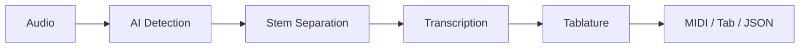

# 🎸 Tab Agent

[](https://github.com/sgm-audio/tab-agent-pro/actions/workflows/ci.yml)
[](https://www.python.org/downloads/)
[](LICENSE)

**Upload guitar or bass audio. Get tablature, MIDI, and JSON back.**

Tab Agent runs local audio-to-MIDI transcription and suggests guitar or bass
fingerings. Treat the exports as drafts to check against the recording. Dense
chords, overlapping instruments, and articulations can be transcribed incorrectly.
See the [baseline evidence audit](docs/SUBSTANTIATION_LOG.md).

---

## Quick Start

### Web UI (Linux CPU, Python 3.11+)

```bash
python -m venv .venv
source .venv/bin/activate
python -m pip install --upgrade pip
python -m pip install torch==2.5.1 torchaudio==2.5.1 --index-url https://download.pytorch.org/whl/cpu
python -m pip install --no-deps -r requirements.lock
python tools/check_lockfile.py
python app.py
# Open http://localhost:7860
```

Install FFmpeg and libsndfile from your system package manager for broader
format support. Use a separate environment for dev tools; run
`python tools/check_lockfile.py --verify` there instead of the exact check.
The lock pins the runtime set, including transitive dependencies. Use it rather
than a plain `pip install -r requirements.txt` on Linux: the latter asks Basic
Pitch to install TensorFlow even though Tab Agent uses ONNX. The Docker image
uses Python 3.12.

The server binds to `HOST` (default `0.0.0.0` so Docker containers can reach
it) and listens on `PORT` (default `7860`). Both are read from the environment
or from an optional `.env` file — see `.env.example`.

The **web UI** limits uploads to 50 MB and 5 minutes and accepts
`.wav .mp3 .flac .ogg .m4a .aiff`; results are returned as a ZIP archive. The CLI
has no such limits — it processes whatever file you point it at, however long.

### CLI

```bash
python main.py input/your_song.wav
# Output: output/your_song_lead_guitar.tab
```

Useful flags:

```bash
python main.py song.wav --instrument Bass          # default: Guitar
python main.py song.wav --profile rock_drop_d      # preset profile (see init_memory.py --list)
python main.py song.wav --onset 0.4 --frame 0.3    # override profile thresholds
python main.py song.wav --no-midi --no-tab         # export JSON only
python main.py song.wav --output-dir /tmp/out
```

### Docker

```bash
docker build -t tab-agent .
docker run -p 7860:7860 -v $(pwd)/input:/app/input -v $(pwd)/output:/app/output tab-agent
# or run the CLI inside the image:
docker run -v $(pwd)/input:/app/input -v $(pwd)/output:/app/output tab-agent python main.py input/your_song.wav
```

The image binds `0.0.0.0:7860` and ships Basic Pitch with its ONNX backend plus
the stem-separation stack.

### Validation

```bash
python -m pytest tests/            # run regression tests (requires dev tools)
python validate.py                 # end-to-end checklist (PASS/FAIL summary)

python tools/check_index.py           # ReaPack index format
python tools/check_env_example.py     # every documented env var is read
python tools/check_docker_install.py  # basic-pitch pin + required deps
python tools/check_reaper_settings.py # Lua settings and completion fixture
python tools/check_lockfile.py        # installed env == requirements.lock
python tools/check_vulns.py           # advisories: none unaccepted/expired
python tools/simulate_failures.py     # failure-mode checks
```

---

## Pipeline



| Stage | Tool | What it does |
|-------|------|-------------|
| **Quality Analysis** | SunoDetector | Detects AI-generated audio artifacts, adjusts thresholds |
| **Stem Separation** | Demucs (htdemucs) | Splits the mix into vocals / drums / bass / other; `bass` is transcribed as bass and `other` as guitar |
| **Spatial Processing** | Mid-Side | Splits lead (centre) from rhythm (sides) by subtraction |
| **Transcription** | Basic Pitch | Converts audio → MIDI notes |
| **Tablature** | Time-aware search | Assigns notes to free strings within a conservative fret span; omitted notes are reported |
| **Technique hints** | Timing and fret geometry | Suggests slides and legato marks; does not recognize how a note was played |
| **Export** | — | MIDI, ASCII tab, JSON |

---

## Features

- **Basic Pitch transcription** — Spotify's lightweight ONNX model, no GPU required
- **Full-mix processing** — Demucs separates the mix; the residual `other` stem (guitars and other instruments) is transcribed as guitar
- **Multi-track output** — Lead, rhythm L/R and bass estimates in separate files; raw-audio fallback is flagged in the UI/CLI and tab/JSON
- **Timed tablature** — Identical onsets share a column; held notes reserve their strings until release
- **AI audio support** — Automatic detection and cleanup for Suno/Udio AI-generated audio
- **Technique hints** — Slides (`s`), hammer-ons (`h`) and pull-offs (`p`) mark plausible transitions, not verified articulations
- **Plug-and-play presets** — 8 profiles (standard, drop D, classical, 4/5-string bass, Suno cleanup, live band) applied with `--profile`
- **REAPER actions** — The Settings script passes its values through to the CLI; see manual loading below
- **CPU by default, GPU optional** — the transcription stack runs on CPU out of
  the box. GPU acceleration is available on the end user's local hardware via
  the `DEVICE` environment variable: `cuda` (NVIDIA CUDA), `rocm` (AMD ROCm),
  `vulkan` (AMD Vulkan), `mps` (Apple Silicon), `directml` (Windows DirectML),
  or `auto` (default — detects the best available backend, falls back to CPU).
  The default Docker image installs CPU-only torch; build a GPU image with
  `docker build --build-arg TORCH_INDEX_URL=...` (see the `Dockerfile`).

- **Local inference** — Basic Pitch weights ship in its wheel. Demucs may need
  network access to acquire upstream weights on first run. If separation fails,
  the pipeline warns and transcribes unseparated audio.

> **Basic Pitch status:** `agents.py` loads Spotify's Basic Pitch (ONNX) as the
> transcription backend. The Docker image ships Basic Pitch only.

---

## Configuration

Environment variables (all optional; `.env` is read by `app.py`, `main.py`, and `run.sh`):

| Variable | Default | Purpose |
|----------|---------|---------|
| `HOST` | `0.0.0.0` | Bind address for the web UI |
| `PORT` | `7860` | Port for the web UI |
| `DEVICE` | `auto` | Compute device for transcription: `auto`, `cpu`, `cuda`, `rocm`, `vulkan`, `mps`, `directml` |
| `MAX_CONCURRENT_REQUESTS` | `1` | Transcriptions allowed in flight at once |
| `QUEUE_MAX_SIZE` | `32` | Bounded backlog; requests beyond this are rejected |
| `UPLOAD_TTL_SEC` | `900` | Upload temp files older than this are pruned |

Preset profiles configure tuning, thresholds and processing behaviour. Applying a
profile writes it to user memory so later runs (and the REAPER scripts) reuse it:

```bash
python init_memory.py --list                 # list the 8 profiles
python init_memory.py --profile bass_5_string
python main.py song.wav --profile suno_aggressive
```

Threshold precedence: explicit CLI flag → active profile → built-in default.

---

## Output Formats

| Format | Content | Use case |
|--------|---------|----------|
| **MIDI** (`.mid`) | Transcribed note events before string assignment | Import into a DAW |
| **ASCII Tab** (`.tab`) | Fretboard notation with onset times in seconds | Read and check against the recording |
| **JSON** (`.json`) | Tuning in low-to-high MIDI pitches, string/fret assignments with onset and release times, and omitted-note records | Custom applications |

### Example tablature output

Synthetic six-note E-major voicing, illustrating the format (not an audio
transcription benchmark):

```text
=== Guitar Tablature ===
Tuning (low to high): E2 A2 D3 G3 B3 E4

t(s)|0.000
   E|0
   B|0
   G|1
   D|2
   A|2
   E|0

Technique hints (heuristic only): s=slide, h=hammer-on, p=pull-off
```

A column represents one onset; `-` means no new note on that string at that
onset. JSON includes durations and `skipped_notes`, with a pitch, start time,
end time and reason for each input event the fingering search could not place.
MIDI retains those events. A CLI run that transcribes no notes exits with code 2
instead of reporting success. The search enforces string occupancy and a
four-fret span for held, fretted notes, not every constraint of human fingering.

---

## REAPER Integration

1. Install the Python dependencies and confirm the CLI runs outside REAPER.
2. In **Actions → Show action list**, use **ReaScript: Load** to load
   `reaper/Settings.lua` and `reaper/TabAgent.lua` from this checkout.
3. Run the Settings action and point it at the checkout containing `main.py`.
4. Glue and select the audio item you want analysed, then run the Tab Agent action.

The action uses `python3` (`python` on Windows) from REAPER's PATH. Settings
stores profile, instrument, onset/frame thresholds, output directory and export
toggles in ExtState. Pipeline messages appear in the REAPER console; pipe reads
can block while Python is quiet. Use a fresh output directory per run to avoid
old files sharing the same basename. The checked-in actions are tested against
a Lua API fixture; native REAPER and the separately indexed ReaPack release
have not been re-verified.

---

## Project Structure

```
├── app.py                 # Gradio web UI + FastAPI health endpoints
├── agents.py              # Splitter, Ear, Tab agents
├── main.py                # CLI pipeline + tab/JSON export helpers
├── suno_postprocessor.py  # AI audio artifact detection
├── init_memory.py         # Preset profiles
├── monitoring.py          # Structured logging + health
├── validate.py            # End-to-end checklist
├── reaper/                # REAPER Lua scripts
├── tools/                 # Config/deployment guard scripts
├── tests/                 # Regression tests
├── examples/              # Demo audio
├── docs/RUNBOOK.md        # Deploy / monitor / rollback / dependency refresh
├── docs/ACCEPTED_RISKS.md # Every known risk, with exposure and expiry
├── SECURITY.md            # Threat model + disclosure process
├── requirements.lock      # Exact runtime pins (CPU-only by default)
├── .pip-audit-ignore      # Accepted advisories; CI fails when one expires
├── pyproject.toml         # Project config
├── Dockerfile             # Local / GPU container build (non-root, read-only code)
└── CHANGELOG.md           # Release history
```

---

## Security

- **Reporting:** see [`SECURITY.md`](SECURITY.md) — private advisories, not public issues.
- **Threat model:** single-tenant, unauthenticated by design; the hosting platform is the trust boundary.
- **Known risks:** [`docs/ACCEPTED_RISKS.md`](docs/ACCEPTED_RISKS.md) lists every accepted
  exception with exposure analysis and expiry; reported advisories must have an
  active exception to pass the scan.
- **Gates:** `bandit` (SAST), `gitleaks` (secrets), `pip-audit` against the installed
  set (`tools/check_vulns.py`), and a lockfile check — all blocking in CI.
- **Dependencies:** `setuptools==80.10.2` is locked because Basic Pitch 0.4.0's
  resampy dependency still imports `pkg_resources`. See the accepted-risk note
  before upgrading it.
- **Model provenance:** Basic Pitch and Demucs weights come from their upstream
  project repositories; pin dependency versions via `requirements.lock` for
  reproducible builds.

---

## Deploying

### Docker (local)

```bash
# CPU image (default, works everywhere)
docker build -t tab-agent .
docker run -p 7860:7860 -v $(pwd)/input:/app/input -v $(pwd)/output:/app/output tab-agent

# Open http://localhost:7860

# CLI inside the image:
docker run -v $(pwd)/input:/app/input -v $(pwd)/output:/app/output tab-agent python main.py input/your_song.wav
```

### GPU images (CUDA / ROCm / Vulkan)

Override the torch index at build time so `torch`/`torchaudio` resolve CUDA or
ROCm wheels instead of CPU, and install the matching ONNX Runtime package for
Basic Pitch:

```bash
# NVIDIA CUDA
docker build --build-arg TORCH_INDEX_URL=https://download.pytorch.org/whl/cu128 \
             -t tab-agent-cuda .
docker run -e DEVICE=cuda -p 7860:7860 tab-agent-cuda

# AMD ROCm
docker build --build-arg TORCH_INDEX_URL=https://download.pytorch.org/whl/rocm6.0 \
             -t tab-agent-rocm .
docker run -e DEVICE=rocm -p 7860:7860 tab-agent-rocm

# AMD Vulkan (Basic Pitch via ONNX Vulkan EP; Demucs stays on CPU)
# Build the CPU image, then install onnxruntime-vulkan at runtime and set:
docker run -e DEVICE=vulkan -p 7860:7860 tab-agent
```

`DEVICE=auto` (the default) detects the best available backend and falls back
to CPU. Health checks: `/health` (liveness + component detail), `/ready`
(503 until a transcription backend is loadable — used by the container
healthcheck), and `/health/metrics` (per-stage timings). Demucs loss degrades
output quality but does not fail readiness, because separation has a passthrough
fallback.

---

## License

MIT — use it, modify it, share it.

---

*Built with [Basic Pitch](https://github.com/spotify/basic-pitch) by Spotify Research,
[Demucs](https://github.com/facebookresearch/demucs) by Meta,
and [Gradio](https://gradio.app).*
